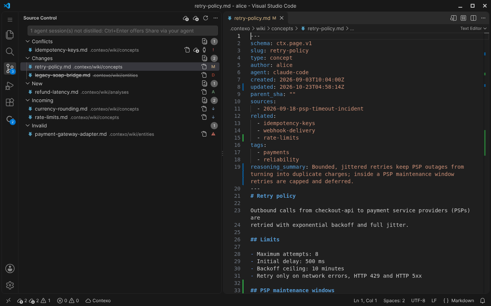
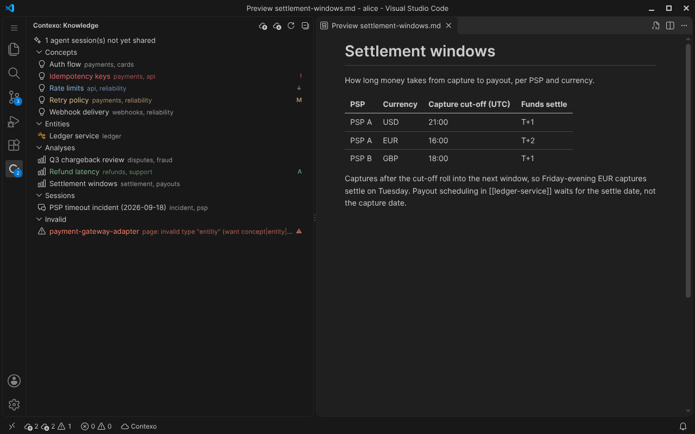
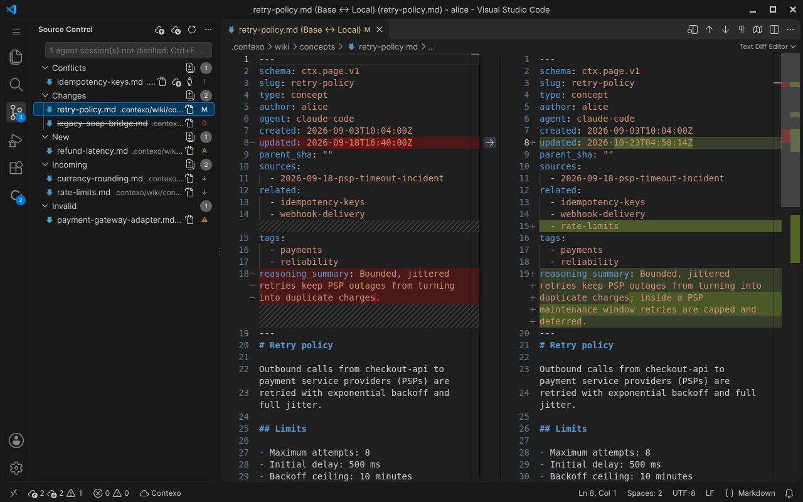

# Contexo for VS Code

> **Preview.** This is an early release. Commands, views and settings may change between releases.

The official [Contexo](https://contexo.live/vscode/) extension for the `ctx` CLI. Contexo is GitHub for AI agent knowledge, scoped per project: the decisions, rejected alternatives and dead-ends that you and your agents work out become pages in the project's `.contexo/` knowledge base, and the whole team syncs them through a Contexo server.

This extension puts that knowledge base inside VS Code. Changed, new, incoming and conflicting pages appear in the Source Control view, every page is listed in a Knowledge view, and you push, pull and resolve conflicts without leaving the editor. Everything goes through `ctx`, the same CLI your agents use, so the editor, the terminal and your agents always agree on each page's state.



## Requirements

- **ctx 0.7.0 or later.** The extension asks `ctx version --json` which contract the binary speaks (contract v1) and which features it has, and never compares version numbers, so release, pre-release and `dev` builds all work. An older ctx shows **Update ctx**; a ctx made for a newer contract asks you to update the extension instead.
- **ctx on this machine.** The extension looks for `ctx` in this order and uses the first one it finds:
  1. the `contexo.path` setting (machine scope, absolute paths only)
  2. your `PATH`
  3. `~/.local/bin/ctx` (where the macOS and Linux install script puts it)
  4. `%LOCALAPPDATA%\Programs\contexo\ctx.exe` (where the Windows install script puts it)
  5. `~/go/bin/ctx` (`go install`)
  6. `/opt/homebrew/bin/ctx`, then `/usr/local/bin/ctx`

  Paths ending in `.cmd`, `.bat` or `.ps1` are rejected, because VS Code cannot start them without a shell: on Windows, point `contexo.path` at `ctx.exe`.
- **A Contexo project.** Run `ctx init` in the project folder and log in with `ctx auth login`. In a remote window (Remote-SSH, WSL, Dev Containers, Codespaces), where ctx cannot open your local browser, use `ctx auth login --no-browser`: ctx prints a link and you paste the token back.
- **A trusted workspace.** Contexo runs `ctx`, which talks to your Contexo server with your credentials, so VS Code disables the extension in Restricted Mode. Trust the folder to use it.
- **VS Code 1.100 or later**, or an editor built on it that installs extensions from Open VSX, such as Cursor.

## Getting started (about 60 seconds)

1. Install ctx, or run **Contexo: Install ctx** from the Command Palette, which shows this command and runs it in a terminal once you confirm:
   - macOS and Linux: `curl -fsSL https://raw.githubusercontent.com/sugihAF/Contexo/main/scripts/install.sh | sh`
   - Windows (PowerShell): `iwr -useb https://raw.githubusercontent.com/sugihAF/Contexo/main/scripts/install.ps1 | iex`
2. Open your project folder and trust it.
3. Run `ctx init` in the folder, or **Contexo: Initialize Contexo**.
4. Run `ctx auth login`, or **Contexo: Log In**.
5. Open the Source Control view (Ctrl+Shift+G, Cmd+Shift+G on macOS) and the Contexo view in the Activity Bar.

The [VS Code guide](https://docs.contexo.live/guides/vscode/) walks through the first run, how the extension finds ctx, remote windows and troubleshooting.

## What you see

### Knowledge view

The Contexo view in the Activity Bar lists the project's pages by type: Concepts, Entities, Analyses, Sessions (raw agent session notes, hidden with `contexo.tree.showSessions`) and Other. Pages that ctx cannot use (broken frontmatter, a missing required field, or a file whose path does not match its frontmatter) appear under an **Invalid** node, with the problem in the tooltip. When agent sessions are waiting to be shared, an item at the top says how many; clicking it copies a prompt for your agent.



### Source Control

Each workspace folder that holds a Contexo project gets its own Contexo entry in the Source Control view, with these groups:

| Group | Pages |
|---|---|
| Conflicts | You and a teammate both changed the page, or both created it. |
| Changes | You changed the page, or deleted it locally. |
| New | You created the page; it is not on the server yet. |
| Incoming | A teammate changed the page, or created it, on the server. |
| Invalid | ctx cannot read the page; fix the problem shown in its tooltip. |

`ctx` computes every state, from your file, the last version you synced and the server. The extension only shows what ctx reports. The badge counts conflicts, changes and new pages (and incoming pages too with `contexo.scm.countIncoming`). The status bar shows the pages to push, the incoming pages and the conflicts; clicking it refreshes. A second status bar item tells you when you need to log in, install or update ctx.

Clicking a page opens a diff: from the last synced version to your file for Changes, from empty for New, and from the server's version to your file for Incoming and Conflicts. The editor gutter marks the lines you changed since the last sync, and the Explorer, Source Control and Knowledge views badge each page with its state.



## Push

Type an optional message in the Source Control message box and press Cmd+Enter (macOS) or Ctrl+Enter, or click **Push**. Push sends only your changed and new pages; **Push Selected** in a page's menu sends just the selected ones. Invalid pages and pages in conflict are never sent.

- **Conflicts are reported, never overwritten.** If a teammate pushed the same page first, the push names every conflict and offers **Show Conflicts**; the server keeps the teammate's version until you resolve it.
- **Agent sessions first.** If agent sessions have not been distilled into the knowledge base yet and you are pushing concept or analysis pages, the push is refused. Contexo offers **Share via your agent** instead: it copies a prompt that has your agent push the pages through its Contexo MCP server, which distills the pending sessions first, so the decision record is kept. The extension never bypasses this check.
- **Unsaved pages.** Push and Pull work on the files on disk. If a Contexo page has unsaved changes, you are asked to **Save All and Continue** or Cancel first.

## Pull

Pull brings in incoming pages and **never overwrites local edits**. It skips every page you changed, every conflict, invalid page and page you deleted, and tells you which local edits it kept. A page whose server version is identical to your file is simply marked as synced.

## Conflicts

Click a conflicting page to compare the server's version with yours, then choose from its menu:

- **Keep Mine** runs `ctx resolve --ours`: your version stays and is now based on the server's current version. Push it to publish it.
- **Take Server Version** runs `ctx resolve --theirs` after a confirmation: your file is replaced by the server's version, and ctx keeps a backup of yours in `.contexo/.sync/backup/`. It refuses while that file has unsaved changes: save or revert it first.

Both pass the server version you looked at (`--if-server-sha`). If a teammate pushed again in the meantime, nothing is resolved and you are asked to review the new diff.

## Commands

| Command | What it does | Where |
|---|---|---|
| Contexo: Refresh | Re-reads the status from ctx and checks the server for incoming changes. | Command Palette, Source Control title bar, Knowledge view title bar |
| Contexo: Show Log | Opens the Contexo output channel (every ctx call, its exit code and timing). | Command Palette, Source Control title bar |
| Contexo: Open in Dashboard | Opens the project, or the selected page, in the Contexo web dashboard. Unavailable when the project has no dashboard URL. | Command Palette, Source Control title bar, Source Control page menu, Knowledge view item menu |
| Contexo: Log In | Runs `ctx auth login` in a terminal. In a remote window it adds `--no-browser`, so ctx prints a link and asks you to paste the token. | Command Palette, Source Control title bar |
| Contexo: Initialize Contexo | Runs `ctx init` in a terminal for a workspace folder that has no Contexo project yet. | Command Palette |
| Contexo: Install ctx | Shows the official install command and, only after you confirm, runs it in a terminal. | Command Palette |
| Contexo: Update ctx | Runs `ctx update` in a terminal, then finds ctx again. | Command Palette |
| Contexo: Share via Your Agent | Copies a prompt for your agent (Claude Code, Cursor, Codex) to push your pending pages through its Contexo MCP server, which distills the pending sessions first. | Command Palette, Knowledge view item menu |
| Contexo: Open Changes | Opens the diff for a page: last synced version to local for Changes and New, server to local for Incoming and Conflicts. | Source Control page menu |
| Contexo: Open File | Opens the page's working file. | Source Control page menu, Knowledge view item menu |
| Contexo: Open Server Version | Opens the server's version of an incoming or conflicting page, read-only. | Source Control page menu |
| Contexo: Open All Changes | Opens the diff of every page in a group. | Source Control group |
| Contexo: Push | Pushes every changed and new page (`ctx push`). The Source Control message box becomes the push message. | Command Palette, Source Control title bar, Knowledge view title bar, Ctrl+Enter / Cmd+Enter in the Source Control message box |
| Contexo: Push Selected | Pushes only the selected changed or new pages. | Source Control page menu |
| Contexo: Pull | Pulls incoming pages (`ctx pull`). Never overwrites a page you changed. | Command Palette, Source Control title bar, Knowledge view title bar |
| Contexo: Keep Mine | Keeps your version of a conflicting page (`ctx resolve --ours`); push it afterwards. | Source Control page menu |
| Contexo: Take Server Version | Replaces your version with the server's (`ctx resolve --theirs`), after a confirmation. A backup is kept. | Source Control page menu |
| Contexo: Restore Server Version | Brings back a page you deleted locally from the server. | Source Control page menu |

The Source Control and Knowledge view menus show only the actions that fit the page's state, for example **Keep Mine** and **Take Server Version** for a conflict.

## Settings

| Setting | Default | Description |
|---|---|---|
| `contexo.path` | `""` | Absolute path to the `ctx` binary. Leave empty to search `PATH` and the standard install locations. Relative paths are ignored. On Windows point it at `ctx.exe`, not a `.cmd` shim. Machine scope: set it in your User (or Remote) settings, not in workspace settings. |
| `contexo.remoteRefresh.enabled` | `true` | Check the Contexo server for incoming changes while the window is focused. |
| `contexo.remoteRefresh.intervalSeconds` | `180` | Seconds between server checks while the window is focused (60 to 86400). |
| `contexo.scm.countIncoming` | `false` | Include incoming pages in the Source Control badge count. |
| `contexo.decorations.enabled` | `true` | Show Contexo page state decorations in the Explorer, Source Control and Knowledge views. |
| `contexo.tree.showSessions` | `true` | Show the Sessions group (raw agent session notes) in the Knowledge view. |

## Tips

- ctx keeps its last-synced copies, backups and conflict copies in `.contexo/.sync/`, and writes a `.gitignore` there so they are never committed. To hide them from the Explorer and from search, add this to your settings:

  ```json
  "files.exclude": { "**/.contexo/.sync": true }
  ```

  If `.contexo/.sync/` was committed anyway (for example with `git add -f`), remove it from Git once with `git rm -r --cached .contexo/.sync`.
- By default `ctx init` adds `.contexo/` to `.gitignore`, so Git also dims these files with its ignored-file color next to Contexo's badges. That is expected.
- Teams that commit `.contexo/` (`ctx init --no-gitignore`) also get Git's own quick diff on these files, next to Contexo's.

## Limitations

This preview covers sync for a single knowledge base per folder. Not yet included:

- **Deletes are not synced.** A page you delete locally shows in Changes as deleted and is not counted in the badge; push never deletes it on the server. **Restore Server Version** brings it back.
- **No history in the editor.** There is no history, timeline or log view (use `ctx history` and `ctx log`), and each page of a push is committed separately on the server rather than as one commit.
- **Older self-hosted servers.** A server without the `pages.at` capability (self-hosted servers older than Contexo 0.7.0) cannot serve a page as of a given commit. ctx then cannot rebuild a missing last-synced copy, so such pages stay unverified (in no group) until you pull or resolve them. The hosted service supports it.
- **Formatting-only differences.** ctx pushes a normalized copy of a page's frontmatter and does not rewrite your file, so the gutter can show YAML formatting differences on a page whose state is unchanged.
- **Restart agent sessions after `ctx update`.** Agents keep running the Contexo MCP server they started with, and older MCP servers can still overwrite local edits. The extension reminds you once per ctx version.

## Security and privacy

- **Workspace Trust is required.** In Restricted Mode VS Code does not run the extension at all.
- **ctx does all the reading and writing.** The extension never reads your credentials, the project configuration or `.contexo/.sync`, never parses pages, and never writes under `.contexo/`. It only watches `.contexo/` for file changes so it can ask ctx for a fresh status.
- **ctx runs without a shell.** The extension starts `ctx` as a child process with an argument array and no shell, and removes `CONTEXO_DISTILL_DISABLE` from its environment, so a variable set in your shell cannot silently skip the agent-session check. Login, init and update run in a VS Code terminal you can see; **Install ctx** runs the install script only after you confirm.
- **No telemetry.** The extension collects nothing and makes no network requests of its own; only `ctx` talks to your Contexo server, as it does on the command line.
- **The server sees which client pushed.** ctx identifies itself to your Contexo server as `contexo-vscode/<extension version>` (the `X-Contexo-Client` header), so the project's activity shows pushes made from VS Code.

## Remote development

Contexo runs where your files are: on the remote machine in Remote-SSH, WSL, Dev Containers and Codespaces. Install `ctx` there, and if it is not found, set `contexo.path` in the Remote settings (it is a machine setting). **Contexo: Log In** adds `--no-browser` in a remote window, so ctx prints a link to open locally and asks you to paste the token.

## Support

- Report a bug or ask for a feature: [GitHub issues](https://github.com/sugihAF/contexo-vscode/issues). Include the output of **Contexo: Show Log** and of `ctx version`.
- Product page: [contexo.live/vscode](https://contexo.live/vscode/). Documentation: [docs.contexo.live/guides/vscode](https://docs.contexo.live/guides/vscode/).

## License

MIT. See [LICENSE](LICENSE).
